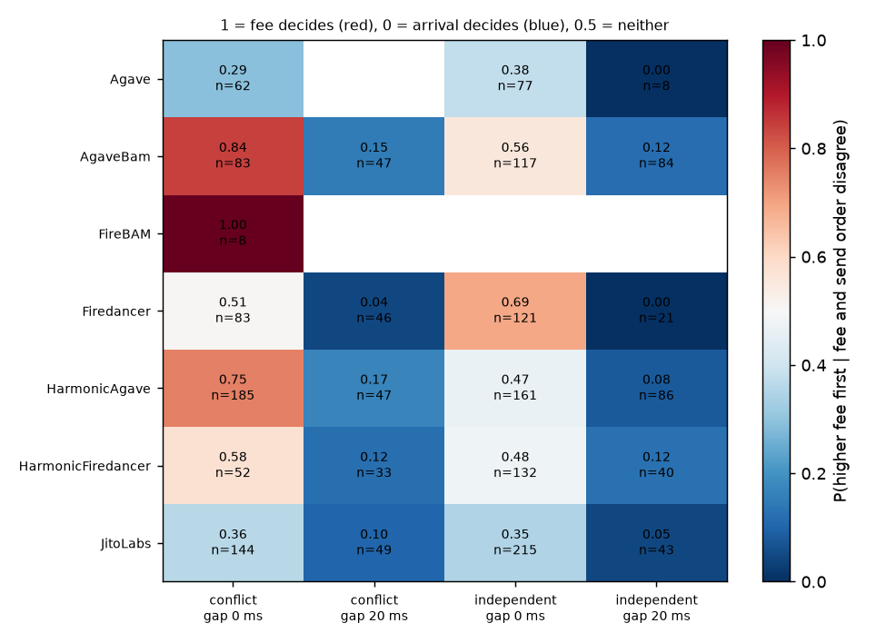
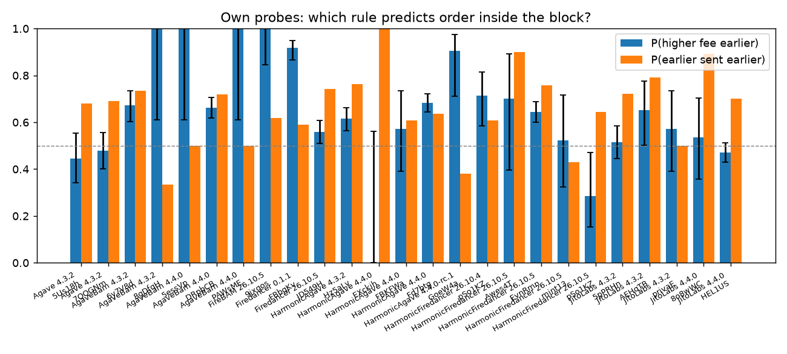

# Report — How Solana mainnet leaders order transactions inside a block

Author: Bogdan Vakhula · Code & raw data: <https://github.com/bogdanio87/solana-tx-ordering>
All times UTC (Kyiv = UTC+2). All mainnet measurements are **after** the Alpenglow switch (slot 459,653,000, 2026-10-21); none before
(the code refuses to send if the current slot is earlier).

## Summary (read this first)

**What we did.** On 2026-11-03 between 15:50 and 16:37 UTC we sent **1,288 of our own probe transactions** to mainnet
(1,280 landed, 99.4%) in 161 bursts of 8, aimed at the leader windows of **12 targeted validators covering 11 client versions
in 6 client families** (Agave, JitoLabs, AgaveBam, HarmonicAgave, Firedancer, HarmonicFiredancer). Leader-rotation spill-over
put probes into blocks of 12 more leaders, so in total probes landed in blocks of **24 validators, 7 client families and
13 client versions** (incl. FireBAM). Every probe costs the same 600 CU; inside a burst its priority fee (0 … 15,000 lamports)
is randomly permuted *against* send order, so fee and arrival order make opposite predictions on ~half of all pairs.
Total spend **0.01037 SOL** (on-chain), cap 0.04 SOL. Every one of the 1,280 landed probes was re-checked by
`scripts/verify.py` against fresh `getBlock` data: **1,280/1,280 verified** (slot, index in block, leader).

**What we found, in plain words.**

1. **Arrival order is the dominant rule on every client.** When probes reach the leader 20 ms apart, the earlier one is
   placed first 89–95% of the time on every client family, and the higher-fee one wins a fee-vs-arrival conflict only
   0–17% of the time (heat-map below, right two columns).
2. **Fee only matters when transactions are in the scheduler's queue *at the same time* and *fight for the same lock*.**
   With 8 probes sent together (gap 0) that all write-lock one account, the BAM leaders (AgaveBam 0.84, FireBAM 1.00) and
   Harmonic-Agave (0.75) order them by fee — reproduced in both runs; stock Agave (0.29) and Jito-Solana (0.36) do **not** —
   they keep (approximate) arrival order even then. For Firedancer 26.10.x and Harmonic-Firedancer the result is
   undetermined (pooled 0.51 / 0.58; the two runs disagree, §5.4).
3. **Non-conflicting transactions sent together show no rule** on most clients (0.35–0.56): parallel banking threads
   interleave them. The exception is the Firedancer **0.1.1** validator (FBbqKvwL), which fee-orders in both arms (0.76 / 0.87),
   while Firedancer 26.10.5 (JD549Hsb) does not — a version difference *inside* one client family.
4. **Paying priority bought nothing for inclusion** at this load: 0-priority probes landed exactly as often (99%) as
   15,000-lamport ones. Across slots, an earlier-sent probe lands in an earlier-or-same slot 87–100% of the time; fee has
   no effect (≈0.5).
5. **Blocks are not fee-sorted against third-party traffic.** Of the other transactions placed before one of our probes,
   a median 65–86% paid *less* priority per CU (FireBAM, one block: 14%). Passive data on 250 blocks agree: |ρ(position,
   priority)| < 0.11 for every client; only the first ~10% of a block is slightly richer in high-priority transactions
   (start-of-slot backlog drained best-first).

**What this does not show** (details in README "What this design does NOT separate"): the leader's actual TPU arrival
times (we only control send time from one location), bundle/tip behaviour (out of scope), behaviour under heavy
congestion, and rules for leaders we hit in only 1–2 blocks (marked *insufficient data*).

## 1. Measurement log (date of every measurement)

| # | What | When (UTC) | Network / slots | Data |
|---|---|---|---|---|
| M1 | Passive survey: 100 blocks, 12 per client class | collected 2026-11-03 15:00:25 – 15:00:58 (block times from 14:49:50) | mainnet, from slot 464,938,456 | `data/passive/2026-11-03-prelim-passive/` |
| M2 | Passive survey (from `docker compose up`), 2 runs | collected 2026-11-03 15:13:31 – 15:13:46 and 15:15:16 – 15:15:29 (block times up to 15:15:02) | mainnet, up to slot 464,945,471 | `data/passive/2026-11-03T15-1*-passive/` |
| M3 | Dry run #1 (12 windows, 96 probes built+signed, not sent) | 2026-11-03 15:13:46 – 15:15:00 | mainnet, slot ≈464.945 M | `data/runs/2026-11-03T15-13-46-298Z-dry/` |
| M4 | Dry run #2 | 2026-11-03 15:15:29 – 15:16:58 | mainnet, snapshot at slot 464,945,600 | `data/runs/2026-11-03T15-15-29-680Z-dry/` |
| M4b | Dry run #3 (in Docker, 4 windows, 32 probes, not sent) | 2026-11-03 15:21:13 – 15:21:44 | mainnet, slots 464,947,195 – 464,947,327 | `data/runs/2026-11-03T15-21-13-133Z-dry/` |
| M5 | Localnet calibration, live sending (64 probes, 8 windows, all 8 conditions) | 2026-11-03 15:08:18 – 15:10:22 | `solana-test-validator` 4.3.2 (Agave), local slots 811–899 | `data/localnet-calibration/` |
| M2b | Passive survey (start of live run 0), 52 blocks | 2026-11-03 15:46:54 – 15:47:10 | mainnet, up to slot 464,954,390 | `data/passive/2026-11-03T15-46-54-586Z-passive/` |
| M6a | Live run 0 — aborted during sub-wallet funding, **no probes sent** (3 funding txs) | 2026-11-03 15:47:12 – 15:49:00 | mainnet | `data/runs/2026-11-03T15-47-12-547Z-live/` |
| M6b | **Live run 1**: 85 bursts, 680 probes, all landed | probes sent 2026-11-03 15:50:11.661 – 16:16:17.655 (= blockTime of first/last landed slot 15:50:11 / 16:16:17) | mainnet, slots 464,955,316 – 464,962,569 | `data/runs/2026-11-03T15-49-19-542Z-live/` |
| M6c | **Live run 2**: 76 bursts, 608 probes, 600 landed | probes sent 2026-11-03 16:20:09.368 – 16:36:44.985 (blockTime 16:20:09 / 16:36:45) | mainnet, slots 464,963,653 – 464,968,294 | `data/runs/2026-11-03T16-19-15-699Z-live/` |
| M7 | Collection of run 2 (`collect`), reclaim of 8 sub-wallets | 2026-11-03 16:37:13 – 16:40:24 | mainnet | `collect_console.log`, `data/runs/reclaim_2026-11-03.log` |
| M8 | Independent re-verification of all 1,280 landed probes (`verify.py --sample 0`) | 2026-11-03 16:41 – 16:43 | mainnet | `data/verify_report.txt` |

Cluster state at M3/M4 (from `getClusterNodes`, 3,876 gossip nodes at 15:15:30): client ids seen include `Agave` (4.1–4.5),
`JitoLabs` (4.3.x, 4.4.0), `AgaveBam`, `HarmonicAgave`, `Firedancer` (26.10.x and 0.1.1), `HarmonicFiredancer`,
`FireBAM`, `Rakurai`. Measured slot time during M3/M4: ≈210 ms (target 200 ms).

## 2. Passive survey (third-party transactions — supplementary evidence)

250 distinct mainnet blocks (M1, M2, M2b; deduplicated), 8 named client classes + 12 blocks from one node with an unstable `Unknown(<id>)` client id; every non-vote transaction. Statistic: Spearman ρ between position and
priority fee per cost unit (negative ⇒ higher priority earlier); "local ρ" inside consecutive chunks of 8/32 txs;
`dec_adjacent` = share of adjacent pairs (with different priority) where priority decreases (0.5 = random).

| client | blocks | leaders | median ρ | IQR ρ | local ρ (8) | local ρ (32) | dec_adjacent | zero-priority share | first-decile priority pct |
|---|---|---|---|---|---|---|---|---|---|
| Unknown(id) | 12 | 1 | −0.101 | −0.15 … −0.05 | −0.011 | −0.009 | 0.507 | 0.33 | 0.53 |
| Firedancer | 30 | 10 | −0.078 | −0.13 … −0.03 | −0.033 | −0.038 | 0.519 | 0.33 | 0.52 |
| FireBAM | 29 | 11 | −0.067 | −0.14 … −0.01 | −0.065 | −0.015 | 0.527 | 0.25 | 0.59 |
| AgaveBam | 30 | 26 | −0.048 | −0.12 … 0.00 | −0.074 | −0.040 | 0.521 | 0.27 | 0.59 |
| HarmonicFiredancer | 30 | 12 | −0.046 | −0.11 … 0.02 | −0.004 | −0.005 | 0.516 | 0.31 | 0.60 |
| HarmonicAgave | 30 | 17 | −0.038 | −0.12 … 0.01 | −0.004 | −0.024 | 0.510 | 0.31 | 0.52 |
| JitoLabs | 30 | 13 | −0.036 | −0.10 … 0.01 | −0.002 | −0.003 | 0.508 | 0.31 | 0.51 |
| Agave | 29 | 6 | −0.024 | −0.06 … 0.02 | 0.020 | 0.008 | 0.498 | 0.26 | 0.51 |
| Rakurai | 30 | 5 | −0.009 | −0.08 … 0.05 | −0.013 | −0.024 | 0.518 | 0.34 | 0.51 |

Charts: `analysis/out/passive_rho_by_client.png`, `passive_priority_by_position.png`, `passive_example_blocks.png`.

**Reading.** No client produces a block that is sorted by priority, globally or locally: |ρ| < 0.1 for every class,
adjacent pairs are ≈50/50. The only consistent signal is that the **first decile** of most blocks carries slightly
higher-priority transactions: mean within-block priority percentile of the first 10% of transactions (last column;
0.5 = no relation; all 250 blocks: 0.54) is highest for HarmonicFiredancer, FireBAM and AgaveBam (0.59–0.60). This is what a *streaming* priority scheduler
predicts: at the start of the slot the buffered backlog is drained best-first; afterwards transactions are scheduled
almost as they arrive, so position in the block is dominated by arrival time, which we cannot observe for third-party
transactions. AgaveBam/FireBAM show the largest local (8-tx) sortedness, consistent with batch-wise sequencing, but the
effect is small. **This is why passive data cannot answer the question** — arrival time, account conflicts and bundles
are all confounded — and why the primary evidence must come from our own probes, where cost is held constant and fee is
randomised against send order.

## 3. Mainnet dry runs (instrument check, nothing sent)

28 bursts (M3, M4, M4b) were armed against real leader windows of 9 client versions; 224 probes were built and signed. Fire-time
error vs plan: median 0.00 slots, max 0.48 slots (≈100 ms), with the slot clock driven by `slotSubscribe` + HTTP
polling. Probe simulation on mainnet (`simulateTransaction`, `sigVerify=false`): success, 600 CU consumed, fee
5 000 + priority lamports exactly as computed. Projected spend of the full live plan (12 validators × 12 windows × 8
probes): **≈0.0086 SOL** (cap 0.05).

## 4. Localnet calibration (does the instrument discriminate rules?)

Same code, live sending, on `solana-test-validator` (Agave 4.3.2, empty blocks, one leader). Not a mainnet
measurement — it shows what each condition looks like when the rule is known (Agave's open-source scheduler).

| arm | send gap | pairs | P(higher fee first) | P(earlier sent first) | P(fee wins \| disagree) | verdict |
|---|---|---|---|---|---|---|
| conflict | 0 ms | 56 | **1.00** [0.94–1.00] | 0.52 | **1.00** [0.88–1.00] | priority (strict) |
| conflict | 20 ms | 56 | 0.61 | **1.00** [0.94–1.00] | 0.00 [0.00–0.15] | arrival/FIFO |
| independent | 0 ms | 56 | 0.57 | 0.62 | 0.45 [0.29–0.62] | no detectable rule |
| independent | 20 ms | 56 | 0.59 | **1.00** | 0.00 [0.00–0.14] | arrival/FIFO |

Interpretation: Agave orders by priority **only among transactions that are in its buffer at the same time and contend
for the same lock**; parallel non-conflicting transactions are interleaved across worker threads (no rule visible in
the flat list); and with 20 ms between arrivals an idle leader schedules each transaction before the next arrives, so
order = arrival order. The design separates these cases, and the same 2×2 (×fire offset) is applied to every mainnet
validator. Ledger vs chain: 922 275 lamports reserved = 922 275 spent on-chain; cap test (200 000 lamports) stopped at
199 050.

## 5. Live mainnet results (primary evidence)

Source: `analysis/out/results.md` (regenerated by `analysis/analyze.py` from `data/`), raw probes in
`data/runs/*-live/probes_final.json` (signature, payer, nonce, fee, priority, send timestamps per endpoint, landed slot),
blocks in `data/runs/*-live/blocks/`. Measurement dates: M6b/M6c above (2026-11-03, 15:50:11 – 16:36:45 UTC).

### 5.1 Coverage, landing, spend

* **Targeted validators: 12** across **11 client versions / 6 client families** (≥6 and ≥3 required):

  | identity | client version | stake (M SOL) | own blocks with ≥2 probes | probe pairs |
  |---|---|---|---|---|
  | DRpbCBMx… | AgaveBam 4.4.0 | 13.04 | 23 | 448 |
  | 6y7V8dL6… | AgaveBam 4.3.2 | 2.92 | 8 | 195 |
  | Fd7btgyS… | HarmonicAgave 4.4.0 | 17.03 | 29 | 553 |
  | Hz5aLvpK… | HarmonicAgave 4.3.2 | 3.94 | 15 | 366 |
  | HEL1USMZ… | JitoLabs 4.4.0 | 16.70 | 32 | 553 |
  | 5pPRHnie… | JitoLabs 4.3.2 | 6.00 | 9 | 198 |
  | EvnRmnMr… | HarmonicFiredancer 26.10.5 | 7.81 | 23 | 434 |
  | pSo1KZXg… | HarmonicFiredancer 26.10.4 (run 1) → 26.10.5 (run 2) | 1.63 | 2 + 1 | 56 + 28 |
  | JD549Hsb… | Firedancer 26.10.5 | 6.21 | 23 | 383 |
  | FBbqKvwL… | Firedancer 0.1.1 | 1.92 | 6 | 168 |
  | 7QQGNm3p… | Agave 4.3.2 | 1.88 | 8 | 159 |
  | 5Us18hLZ… | Agave 4.3.2 | 1.21 | 6 | 81 |

  Plus 12 non-targeted neighbours that received spill-over probes (1–2 blocks each, mostly *insufficient data*), incl. one
  FireBAM 26.10.5 leader (9jxgosAf…) and HarmonicAgave 4.4.0-rc.1 (GoeW4aFK…). Full list: results.md, "Pairwise ordering … per validator".
* **Probes: 1,288 sent** (161 bursts × 8) → **1,280 landed (99.4%)**, 1,177 (91%) inside the targeted 4-slot leader window.
  The 8 that did not land are one whole burst (window 464965936-EvnRmn) that fired ~77 s late after a sandbox pause (§6).
  `meta.fee` equals the computed `5000 + priority` for every landed probe.
* **Fire offset:** firing 1 slot *before* the window → 95% in target (median 1 slot after fire); firing 1 slot *into* the
  window → 87% (median 3). Chart: [`active_slot_offset.png`](analysis/out/active_slot_offset.png).
* **Inclusion vs fee:** 99% landed at **every** priority level, 0 included (table "Inclusion vs priority fee" in results.md).
* **Independent verification:** `python3 scripts/verify.py --sample 0` → `verified 1280/1280` (`data/verify_report.txt`):
  each signature found by fresh `getBlock` at the recorded slot and index, with the recorded leader from `getSlotLeaders`.
* **Spend:** payer started at 40,000,000 lamports; after reclaim the payer holds **29,633,901** and all 8 sub-wallets 0
  (checked with `getMultipleAccounts` 2026-11-03 16:41 UTC) → **10,366,099 lamports = 0.01037 SOL spent on-chain** (26% of the
  0.04 cap). The ledger (`data/spend_ledger.json`) reserved 10,126,025. Reconciliation: 9,924,000 landed probe fees in the
  records + 310,125 for 5 bursts that landed but are missing from the records (§6) + ≈132,000 for ≈26 funding/sweep
  transfers = 10,366,125 ≈ on-chain.

### 5.2 The decisive test: fee vs arrival when they disagree

For each pair of our own probes in the same block we ask whether the higher-fee one is first and whether the earlier-sent
one is first. On pairs where the two rules predict opposite orders, `P(fee wins | disagree)` is 1 for a strict fee
scheduler, 0 for strict FIFO, 0.5 for neither. 95% Wilson intervals. Verdict rules (same as localnet calibration, §4):
lower CI bound > 0.5 ⇒ *priority*, upper bound < 0.5 ⇒ *arrival/FIFO*, else *noise*; <5 disagreeing pairs ⇒ *insufficient data*.

**By client family × condition** (chart above; `analysis/out/verdicts_by_client_condition.csv`):

| client | conflict, gap 0 | conflict, gap 20 ms | independent, gap 0 | independent, gap 20 ms |
|---|---|---|---|---|
| Agave | 0.29 [0.19–0.41] n=62 · FIFO | — | 0.38 [0.28–0.49] n=77 · FIFO | 0.00 [0.00–0.32] n=8 · FIFO |
| JitoLabs | 0.36 [0.29–0.44] n=144 · FIFO | 0.10 [0.04–0.22] n=49 · FIFO | 0.35 [0.29–0.41] n=215 · FIFO | 0.05 [0.01–0.15] n=43 · FIFO |
| AgaveBam | **0.84 [0.75–0.91]** n=83 · priority | 0.15 [0.07–0.28] n=47 · FIFO | 0.56 [0.47–0.64] n=117 · noise | 0.12 [0.07–0.21] n=84 · FIFO |
| FireBAM | **1.00 [0.68–1.00]** n=8 (1 block) · priority | — | — | — |
| HarmonicAgave | **0.75 [0.68–0.81]** n=185 · priority | 0.17 [0.09–0.30] n=47 · FIFO | 0.47 [0.39–0.54] n=161 · noise | 0.08 [0.04–0.16] n=86 · FIFO |
| Firedancer | 0.51 [0.40–0.61] n=83 · noise (runs disagree) | 0.04 [0.01–0.15] n=46 · FIFO | **0.69 [0.61–0.77]** n=121 · priority* | 0.00 [0.00–0.15] n=21 · FIFO |
| HarmonicFiredancer | 0.58 [0.44–0.70] n=52 · noise (runs disagree) | 0.12 [0.05–0.27] n=33 · FIFO | 0.48 [0.39–0.56] n=132 · noise | 0.12 [0.05–0.26] n=40 · FIFO |

n = disagreeing pairs. *Firedancer "independent, gap 0" is driven by the 0.1.1 validator; the 26.10.5 validator alone is 0.55 (noise).

**By targeted validator** (`P(fee wins | disagree)`; full table incl. CIs and neighbours: results.md "Per validator and condition"):

| validator | client version | conflict · 0 ms | independent · 0 ms | conflict · 20 ms | independent · 20 ms | reading |
|---|---|---|---|---|---|---|
| DRpbCBMx | AgaveBam 4.4.0 | **0.84** [0.72–0.91] | 0.58 | 0.09 | 0.10 | fee-orders contended lock, else arrival |
| 6y7V8dL6 | AgaveBam 4.3.2 | **0.86** [0.67–0.95] | 0.48 | (n=6) | 0.07 | same as above |
| Fd7btgyS | HarmonicAgave 4.4.0 | **0.79** [0.71–0.85] | 0.51 | 0.13 | 0.16 | same as above |
| Hz5aLvpK | HarmonicAgave 4.3.2 | 0.63 [0.49–0.75] | 0.40 | 0.29 | 0.04 | leaning fee on contended lock (CI touches 0.5), else arrival |
| HEL1USMZ | JitoLabs 4.4.0 | 0.34 [0.25–0.43] | 0.36 | 0.09 | 0.00 | arrival everywhere |
| 5pPRHnie | JitoLabs 4.3.2 | 0.44 [0.29–0.61] | 0.33 | 0.14 | 0.00 | arrival everywhere |
| 7QQGNm3p | Agave 4.3.2 | 0.31 [0.19–0.46] | 0.40 | — | 0.00 | arrival everywhere |
| 5Us18hLZ | Agave 4.3.2 | 0.25 [0.11–0.47] | 0.33 | — | — | arrival everywhere |
| JD549Hsb | Firedancer 26.10.5 | 0.37 [0.25–0.50] | 0.55 | 0.04 | 0.00 | arrival / no fee rule |
| FBbqKvwL | Firedancer 0.1.1 | **0.76** [0.58–0.88] | **0.87** [0.76–0.94] | — | — | fee-orders when queued together, both arms |
| EvnRmnMr | HarmonicFiredancer 26.10.5 | 0.58 [0.44–0.70] | 0.47 | 0.10 | 0.12 | no fee rule, arrival at 20 ms |
| pSo1KZXg | HarmonicFiredancer 26.10.4/.5 | — | 0.64 / 0.19 | — | — | insufficient (3 blocks) |

Charts: [`active_rule_by_validator.png`](analysis/out/active_rule_by_validator.png) (both probabilities per validator),
[`active_blocks.png`](analysis/out/active_blocks.png) (probe positions in example blocks).

**Interpretation.** The localnet calibration (§4) showed what a priority-queue scheduler with idle capacity looks like:
fee wins only among *simultaneously queued, lock-conflicting* transactions; with 20 ms between arrivals each transaction is
scheduled before the next arrives. On mainnet the AgaveBam / HarmonicAgave / FireBAM leaders and Firedancer 0.1.1 match that
picture. Stock Agave and Jito-Solana do *not* fee-order even our contended burst — consistent with their scheduler
draining each received batch almost immediately on an under-loaded leader, so 8 transactions that left our box within
~1 ms are rarely in the queue together. That a modified block builder (BAM batch sequencing, Harmonic) changes this is
plausible from their designs, but we only observe the outcome, not the mechanism. With the gap at 20 ms **no client
reorders by fee**: arrival order wins 89–95%.

### 5.3 Competition with third-party transactions and across slots

* **Strictness vs others** (results.md "Strictness"): median share of third-party txs placed *before* a probe that pay
  *less* priority per CU — Agave 0.77, AgaveBam 0.65–0.86, JitoLabs 0.79–0.81, HarmonicAgave 0.73–0.76, Firedancer 0.74–0.78,
  HarmonicFiredancer 0.72–0.77, FireBAM 0.14 (7 probes, one block). A 15,000-lamport probe does not jump ahead of the
  cheap transactions that arrived before it.
* **Cross-slot** (bursts split over consecutive slots of the same leader): P(earlier-sent probe in earlier slot) 0.87–1.00
  for every target version; P(higher-fee probe in earlier slot) 0.38–0.70 (≈ chance).
* **Passive** (§2): no block of any client is globally or locally fee-sorted; small first-decile effect only.

### 5.4 Noise vs rule (run-to-run stability)

A cell is called a rule only when its 95% interval excludes 0.5. As a replication check we re-ran the analysis on each run
separately (run 1 15:50–16:16, run 2 16:20–16:37 UTC; different leader slots):

| client family, condition | run 1 | run 2 | stable? |
|---|---|---|---|
| AgaveBam, conflict · 0 ms | 0.88 [0.73–0.95] | 0.82 [0.69–0.90] | yes — priority |
| HarmonicAgave, conflict · 0 ms | 0.76 [0.66–0.83] | 0.75 [0.65–0.83] | yes — priority |
| JitoLabs, conflict · 0 ms | 0.42 [0.32–0.52] | 0.27 [0.17–0.40] | yes — not priority (noise → FIFO) |
| Agave, conflict · 0 ms | 0.32 [0.15–0.54] | 0.28 [0.17–0.43] | yes — not priority |
| every family, gap 20 ms (both arms) | 0.00–0.29 | 0.00–0.18 | yes — FIFO |
| Firedancer 26.10.5 (JD549Hsb), conflict · 0 ms | 0.14 [0.05–0.35] (2 blocks) | 0.52 [0.35–0.67] (2 blocks) | **no** |
| HarmonicFiredancer 26.10.5 (EvnRmnMr), conflict · 0 ms | 0.33 [0.16–0.56] (2 blocks) | 0.71 [0.54–0.83] (2 blocks) | **no** |
| Firedancer 0.1.1 (FBbqKvwL) | — (not hit) | 0.76 conflict / 0.87 independent | one run only |

So the robust conclusions are: *arrival order at 20 ms spacing on every client*, *fee ordering of contended simultaneous
transactions on AgaveBam and HarmonicAgave*, and *no fee ordering on Agave and Jito-Solana*. For the Firedancer-based
clients in the simultaneous-conflict condition, block-to-block variation is larger than the effect: with 2 blocks per run
the pooled values (0.51, 0.58) must be read as **undetermined**, not as "no rule". Pairs inside one block are not
independent, so the Wilson intervals (computed on pairs) are optimistic; the run-split above is the more honest error bar.

## 6. What went wrong / limitations observed

* **Faucet.** Devnet's RPC faucet (`requestAirdrop`) refused airdrops, so the "free devnet end-to-end" step was replaced by a local
  `solana-test-validator` run (same code path, real signed transactions over RPC).
* **v1 transactions on mainnet.** `getBlock` with `maxSupportedTransactionVersion: 0` now fails because blocks contain
  version-1 transactions (`transactionConfig` with `priorityFee`). Older client libraries cannot decode them; we switched
  to raw JSON-RPC with `maxSupportedTransactionVersion: 1` and parse `meta.fee` / `meta.costUnits` ourselves.
* **Public RPC limits.** The public endpoint throttles and occasionally fails `getBlock`; handled by a client-side rate
  limiter (8 req/s) and exponential back-off (visible as `rpc_retry` events in the logs). It slows collection, not
  measurement.
* **Simulation payer.** Simulating with an unfunded fee payer returns `AccountNotFound`; the first version borrowed a
  payer from a recent block that turned out to be closed. Fixed by checking balance and owner before borrowing
  (simulation only, `sigVerify=false`, nothing is sent).
* **Sub-wallet funding is slow** (sequential confirmations), so early windows of the first plan were already in the
  past; the code now re-plans after funding. A cap test also showed the sweep could be refused by the cap, so sweep
  fees are now reserved up-front.
* **Gossip client ids are not stable for some nodes** (`Unknown(<number>)` changes between snapshots); such nodes are
  excluded from targeting and pooled in the passive survey.
* **Slot time ≈ 210 ms**, not 200 ms; the slot clock estimates it online rather than assuming it.
* **Live run 0 aborted during funding.** The 4th sub-wallet funding transfer failed preflight ("Transaction simulation
  failed") because the load-balanced public RPC served a stale balance/blockhash; the run stopped (FATAL) after funding 3
  sub-wallets, no probes sent. Fix: retry loop (fresh balance, `finalized` blockhash, up to 6 attempts) — run 1 started 2
  minutes later. The 3 funded wallets were reused and swept back.
* **Planner chose a 1-window target** (Agave 4.5.0-alpha.4) as second version of a class; now a second version is only
  taken if it has ≥ min(6, windows-per-validator) leader windows.
* **Run 1 stalls.** An RPC response body could hang without timeout (`getLatestBlockhash` aborted at 30 s, then a hang
  16:01:50 → 16:04:41 UTC); the console/log writer stopped at 16:04:41 although probes kept being sent and recorded until
  16:16:17; 27 windows were skipped as "late". Fixes: per-send timeout (`SEND_TIMEOUT_MS`, default 4 s) and body-read timeout.
  Run 1 was stopped by hand at 16:16 and its data collected with the new `collect` mode (`RUN_ID=… node dist/main.js collect`).
* **Sandbox pauses and a rollback → 5 bursts landed but are not in our records.** The experiment ran on a shared cloud VM
  that was paused and resumed (wall-clock jumps observed). Once it was apparently restored from an earlier checkpoint: bursts
  that had already been sent were lost from disk, and the restored process re-used the same nonces. On-chain we found
  **5 bursts (40 txs, 310,125 lamports)** with no record, e.g. payer nonces 481–488 in slot 464,957,413 (blockTime 15:57:41)
  and 641–648 in slot 464,959,501 (16:05:13); the other ~3 were sent by sub-wallets. They are **excluded from the analysis**
  (no send timestamps), and they are why the ledger (10,126,025) under-counts the on-chain spend (10,366,099). The on-chain
  spend guard (balance re-read every 5 bursts, against the 0.04 SOL cap) is the authoritative backstop; total spend stayed at 26% of cap.
* **Run 2: 23 late windows and one lost burst.** After another pause at ~16:29 UTC, one burst (window 464965936-EvnRmn) was
  sent ~365 slots (≈77 s) after its planned slot; none of its 8 probes landed (most likely an expired blockhash). A final
  pause just before 16:36:45 made the remaining 23 windows "late"; we stopped run 2 there (coverage was already sufficient)
  rather than spend more. Runs 1 and 2 fired 85 and 76 of 144 planned windows.
* **Send errors:** 2 of 2,576 RPC sends failed (one `fetch failed`, one HTTP 429); because every probe is fanned out to two
  endpoints, no probe was lost to this. `getBlock` collection hit 123 HTTP-429 retries (back-off handled).
* **A validator changed version mid-experiment** (pSo1KZXg: HarmonicFiredancer 26.10.4 → 26.10.5 between runs); each block
  is classified with the cluster snapshot of its own run.
* **Unbalanced cells.** Conditions are assigned randomly per window, so some validators got no 20 ms windows (FBbqKvwL,
  5Us18hLZ) and FireBAM was only hit by spill-over (1 block). Those cells are reported as missing / insufficient.

## 7. Reproduce / verify

`docker compose up --build` (dry run) · live: see README · `python3 scripts/verify.py --sample 0` re-checks every
landed probe's index and leader with fresh `getBlock` / `getSlotLeaders` calls (last run: 1280/1280, `data/verify_report.txt`) ·
`python3 analysis/analyze.py` regenerates every table and chart in `analysis/out/` from `data/`.
